# Gestión de productos y transacciones

Aplicación web para administrar productos y registrar compras y ventas. El backend está formado por dos microservicios en .NET que se comunican por REST de forma síncrona, y el frontend está hecho en Angular.

## Arquitectura

```
Angular (4200) ──► Products.Api (5001) ──► InvProductsDb
      │                  ▲
      │                  │ HTTP: consulta del producto y ajuste de stock
      └────────► Transactions.Api (5002) ──► InvTransactionsDb
```

- **Products.Api**: productos y categorías. Es el único servicio que modifica el stock.
- **Transactions.Api**: compras y ventas. Antes de guardar una transacción pide a Products.Api que ajuste el stock; si el guardado falla, revierte ese ajuste.
- **Una base de datos por servicio**: `Transactions.ProductId` no tiene llave foránea porque los productos están en otra base.

Cada API sigue la estructura Controller → Service → Repository → DbContext, con DTOs, inyección de dependencias y manejo global de errores con ProblemDetails.

El frontend separa la carpeta `core` (modelos, servicios HTTP e interceptor de errores) de `features` (pantallas de productos y transacciones, cargadas de forma diferida).

## Tecnologías

- .NET 10, ASP.NET Core Web API, Entity Framework Core 10
- SQL Server
- Angular 22, Angular Material

## Requisitos

- .NET SDK 10
- SQL Server (local, con autenticación de Windows)
- Node.js 22 o superior
- Angular CLI: `npm install -g @angular/cli`

## Base de datos

1. Abre `database.sql` en SQL Server Management Studio.
2. Ejecuta el script. Crea las bases `InvProductsDb` e `InvTransactionsDb`, sus tablas y las categorías iniciales.

Si tu instancia de SQL Server no es `localhost`, cambia `ConnectionStrings` en el `appsettings.json` de cada API.

## Ejecución del backend

En dos terminales, desde la carpeta `backend`:

```bash
dotnet run --project Products.Api --launch-profile http
dotnet run --project Transactions.Api --launch-profile http
```

Usa el perfil `http`: el frontend y Transactions.Api esperan los puertos 5001 y 5002.

Documentación de los endpoints:

- Products.Api: http://localhost:5001/swagger
- Transactions.Api: http://localhost:5002/swagger

## Ejecución del frontend

```bash
cd frontend
npm install
ng serve
```

Abre http://localhost:4200

## Endpoints

### Products.Api

| Método | Ruta | Descripción |
|---|---|---|
| GET | `/api/categories` | Lista de categorías |
| GET | `/api/products` | Lista paginada. Filtros: `name`, `categoryId`, `minPrice`, `maxPrice`, `page`, `pageSize` |
| GET | `/api/products/{id}` | Detalle de un producto |
| POST | `/api/products` | Crea un producto con stock 0 |
| PUT | `/api/products/{id}` | Actualiza un producto, sin modificar su stock |
| DELETE | `/api/products/{id}` | Borrado lógico |
| PATCH | `/api/products/{id}/stock` | Ajuste de stock, de uso interno para Transactions.Api |

### Transactions.Api

| Método | Ruta | Descripción |
|---|---|---|
| GET | `/api/transactions` | Lista paginada. Filtros: `productId`, `type`, `from`, `to`, `page`, `pageSize` |
| GET | `/api/transactions/{id}` | Detalle de una transacción |
| GET | `/api/transactions/history/{productId}` | Historial de un producto con su stock actual |
| POST | `/api/transactions` | Registra una compra o una venta y ajusta el stock |
| PUT | `/api/transactions/{id}` | Edita una transacción y ajusta el stock por la diferencia |
| DELETE | `/api/transactions/{id}` | Elimina una transacción y revierte su efecto en el stock |

## Reglas de negocio

- El stock solo cambia con transacciones: una compra lo aumenta y una venta lo disminuye.
- Una venta no puede dejar el stock en negativo. Se valida en el formulario y en el backend con una actualización atómica (`UPDATE ... WHERE Stock + delta >= 0`).
- Al editar una transacción solo se aplica la diferencia entre el efecto nuevo y el anterior.
- El total de cada transacción lo calcula SQL Server (`Quantity * UnitPrice`).
- Las fechas se guardan en UTC y el frontend las muestra en la hora local.

## Evidencias

### Productos

Listado con imagen, categoría, precio y stock.

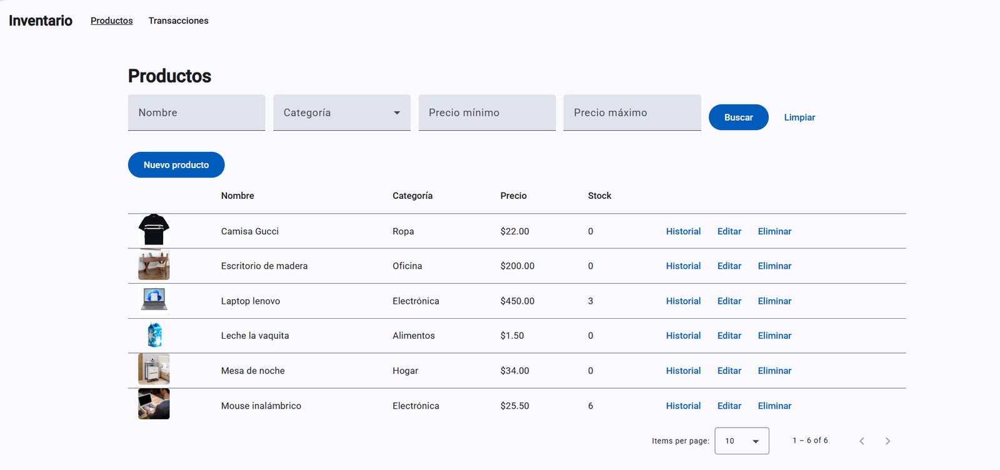

Creación de un producto. El stock no se ingresa: empieza en 0 y cambia con las transacciones.

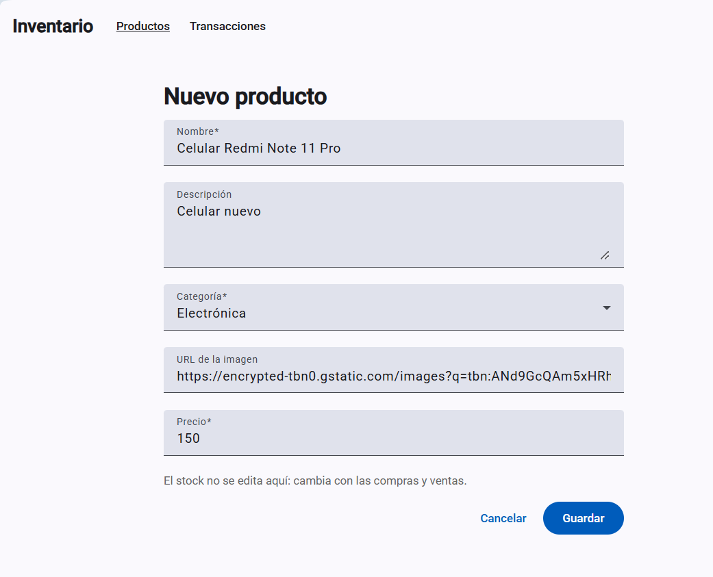

Validaciones del formulario.

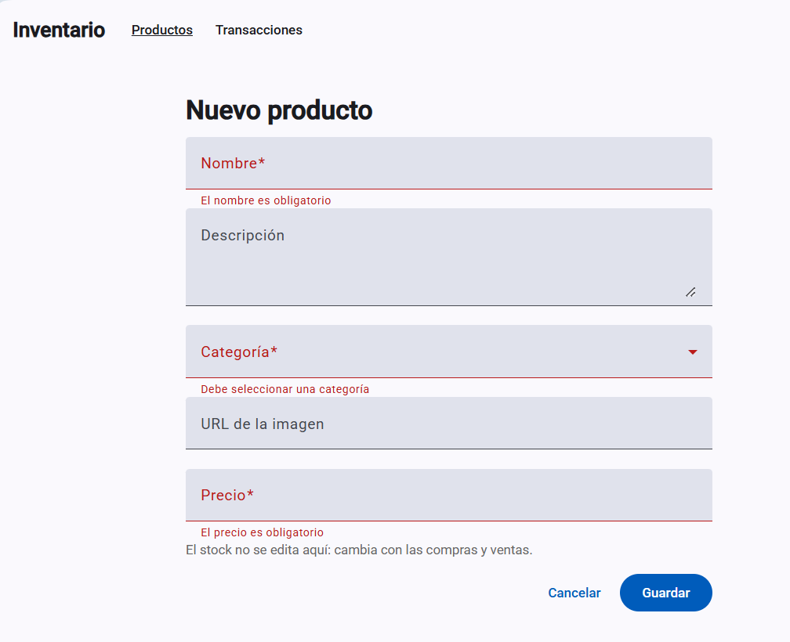

Edición de un producto existente.

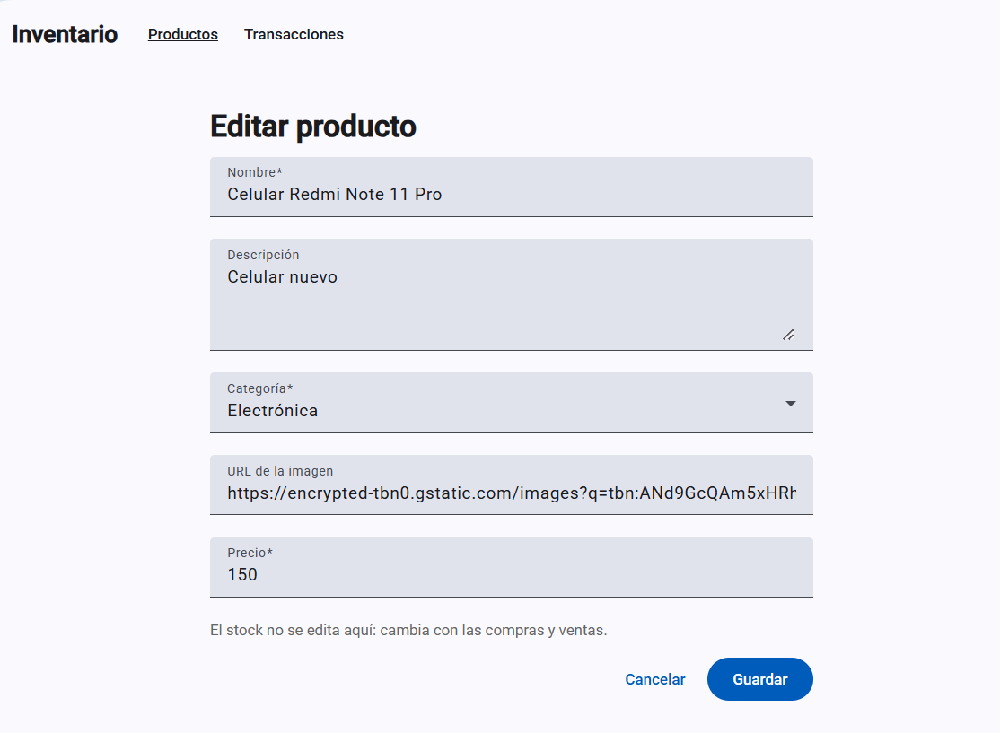

Filtro por categoría.

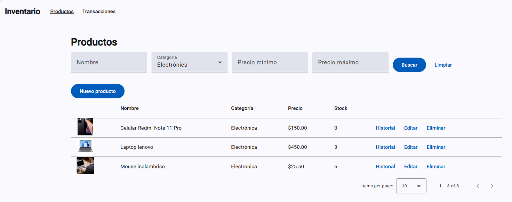

Paginación con 5 elementos por página.

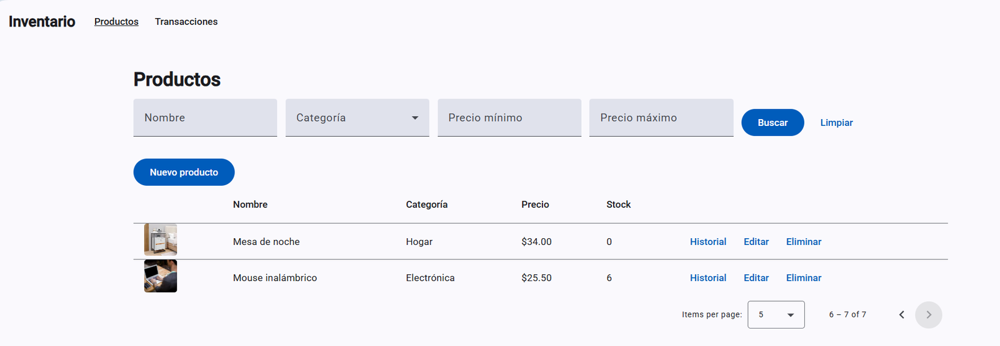

### Transacciones

Registro de una compra, con el stock disponible y el total calculado.

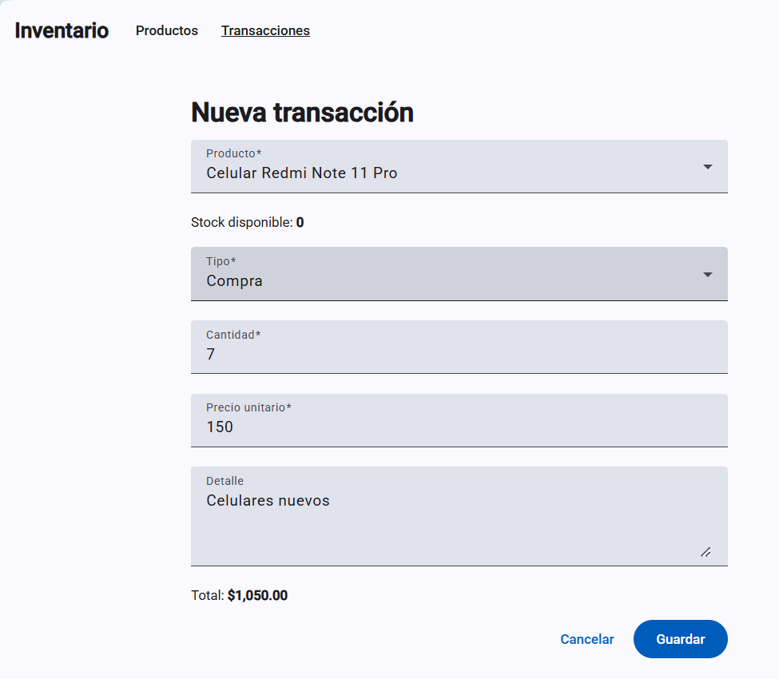

Una venta mayor al stock disponible no se puede guardar.

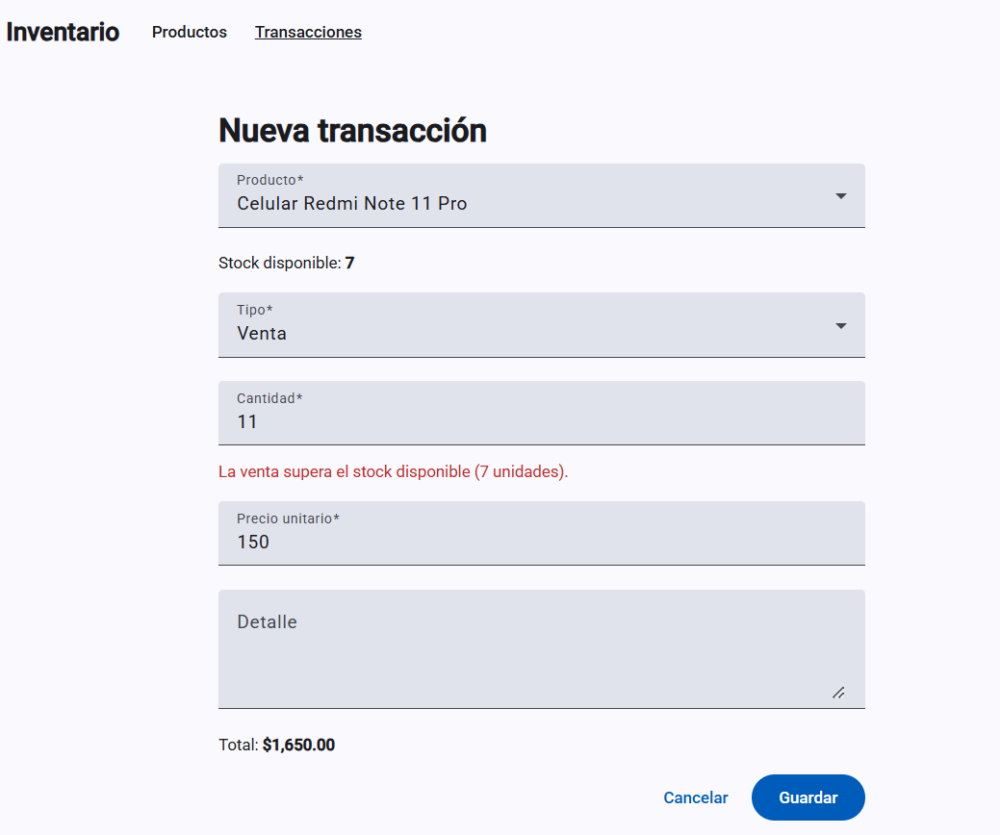

Listado de transacciones.

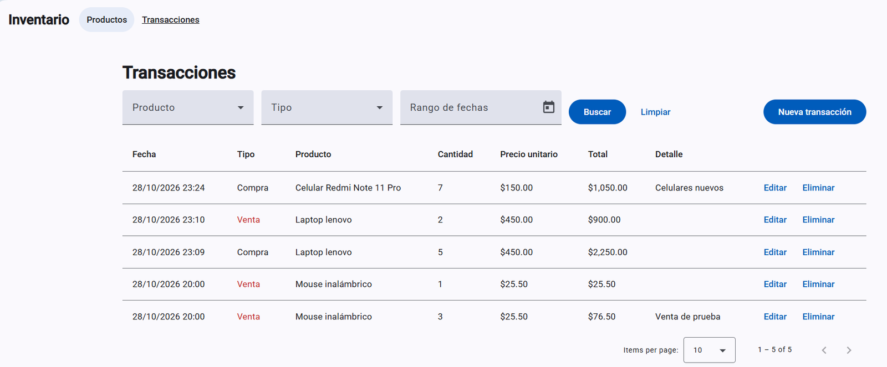

Filtro por tipo de transacción.

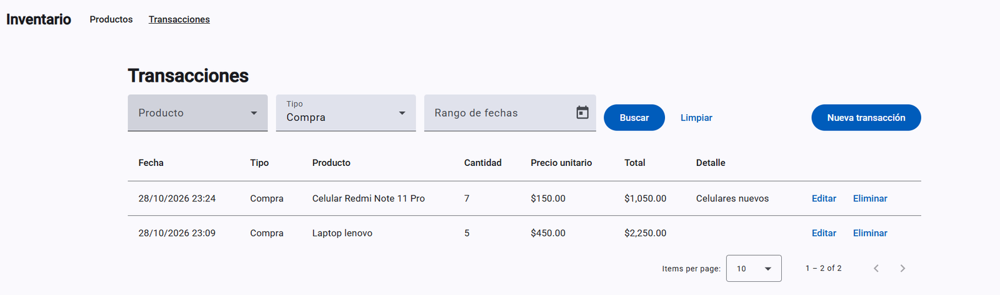

Historial de un producto con su stock actual.

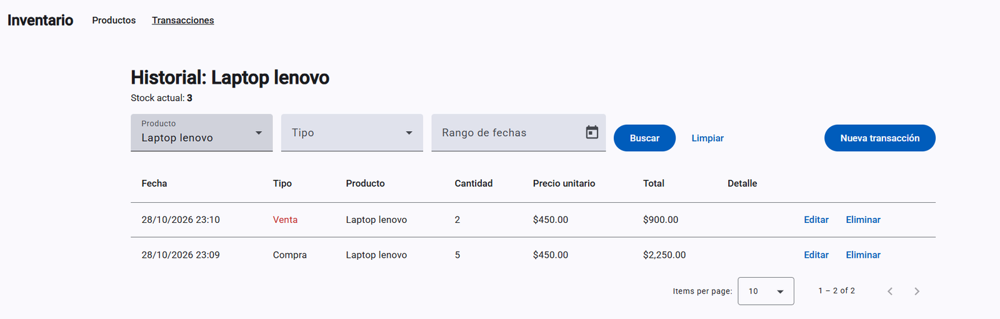

Al eliminar una venta de 2 unidades, el stock vuelve de 3 a 5.

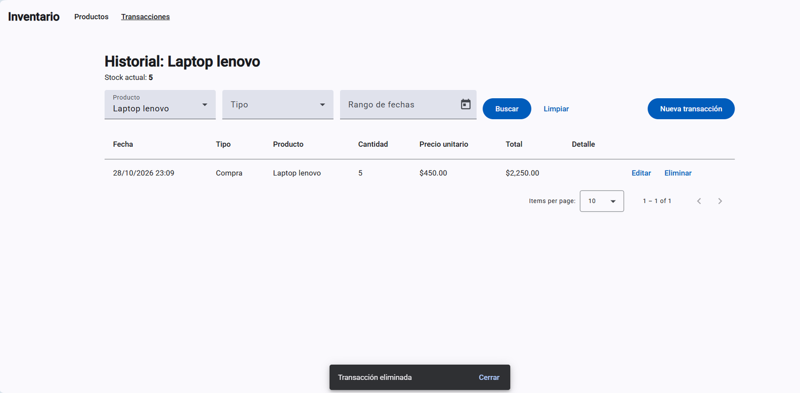

### Manejo de errores

Mensaje cuando el servicio de productos no está disponible.

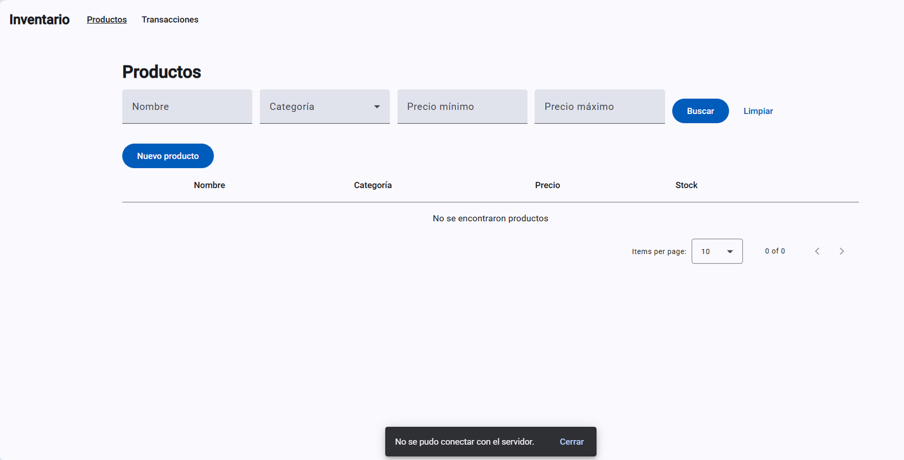
